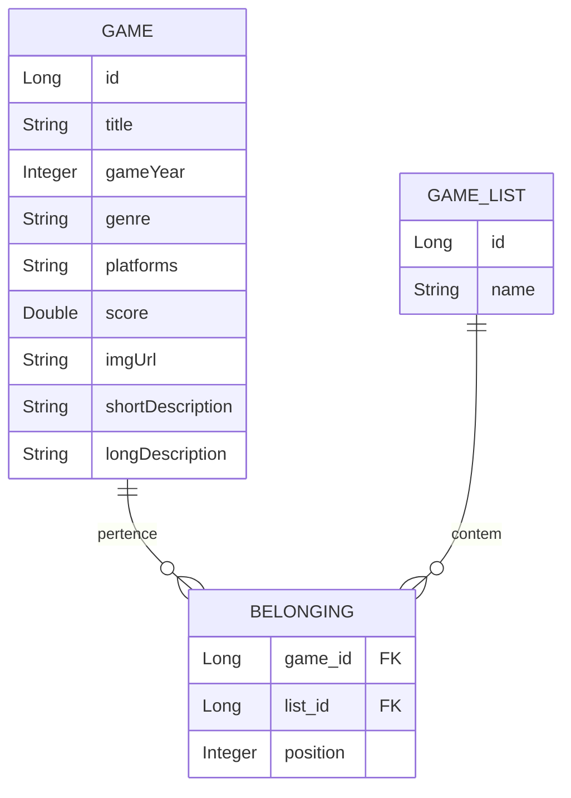
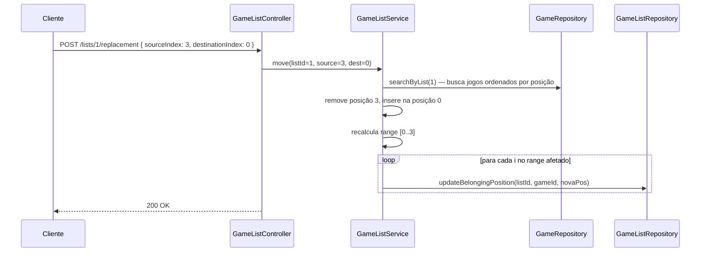

# DSList — API de Listas de Jogos

API REST para gerenciamento e organização de listas de jogos com suporte a **reordenação dinâmica de posição** — o usuário pode mover um jogo dentro de uma lista e a ordem é persistida no banco.

[](https://openjdk.org/projects/jdk/17/)
[](https://spring.io/projects/spring-boot)
[](https://www.postgresql.org/)
[](https://www.h2database.com/)
[](http://localhost:8080/swagger-ui.html)
[](LICENSE)

---

## Modelo de Domínio



---

## Funcionalidade em Destaque — Reordenação

O endpoint `POST /lists/{listId}/replacement` permite mover um jogo de uma posição para outra dentro de uma lista. A lógica recalcula apenas as posições afetadas pelo movimento, sem reescrever a lista inteira:



---

## Destaques Técnicos

### Chave Composta com `@EmbeddedId`
A entidade `Belonging` modela um **many-to-many com atributo extra** (`position`) usando chave composta embutida:
```java
@Entity
@Table(name = "tb_belonging")
public class Belonging {
    @EmbeddedId
    private BelongingPK id = new BelongingPK(); // Game + GameList
    private Integer position;
}
```

### Spring Projections
Queries otimizadas que retornam apenas os campos necessários, sem carregar a entidade completa:
```java
public interface GameMinProjection {
    Long getId();
    String getTitle();
    Integer getGameYear();
    String getImgUrl();
    String getShortDescription();
    Integer getPosition();
}
```

### Múltiplos Perfis de Ambiente
| Perfil | Banco | Uso |
|---|---|---|
| `test` (padrão) | H2 em memória | Desenvolvimento local sem configuração |
| `dev` | PostgreSQL local | Testes integrados |
| `prod` | PostgreSQL via env vars | Deploy em produção |

---

## Stack

| Tecnologia | Versão | Uso |
|---|---|---|
| Java | 17 | Linguagem principal |
| Spring Boot | 3.4.5 | Framework web |
| Spring Data JPA | — | Persistência ORM |
| H2 Database | — | Banco em memória (perfil test) |
| PostgreSQL | — | Banco em produção |
| Springdoc OpenAPI | 2.5.0 | Swagger UI automático |

---

## Como Executar

### Pré-requisitos
- **Java 17** (JDK)
- **Maven 3.9+** (ou utilizar o Maven Wrapper `./mvnw` incluso)
- **Docker e Docker Compose** (opcional, para execução com contêineres e PostgreSQL)

### Com Docker (recomendado — perfil prod)
```bash
git clone https://github.com/odavid062/Dslist.git
cd Dslist
docker compose up --build
```

| Serviço | URL |
|---|---|
| API | http://localhost:8080 |
| Swagger UI | http://localhost:8080/swagger-ui.html |

### Com Maven (perfil test — H2, zero configuração)
```bash
git clone https://github.com/odavid062/Dslist.git
cd Dslist

# Linux / macOS
./mvnw spring-boot:run

# Windows
.\mvnw.cmd spring-boot:run
```

Acesse o console H2 em: `http://localhost:8080/h2-console`
- **JDBC URL:** `jdbc:h2:mem:testdb`
- **User Name:** `sa`
- **Password:** *(em branco)*

### Executar Testes
```bash
# Linux / macOS
./mvnw test

# Windows
.\mvnw.cmd test
```

---

## Variáveis de Ambiente

As seguintes variáveis de ambiente podem ser configuradas para customizar a execução da aplicação (via variáveis de sistema, arquivo `.env` ou `docker-compose.yml`):

| Variável | Descrição | Padrão / Perfil |
|---|---|---|
| `APP_PROFILE` | Define o perfil ativo do Spring Boot (`test`, `dev`, `prod`) | `test` |
| `CORS_ORIGINS` | Origens permitidas para requisições CORS (separadas por vírgula) | `http://localhost:5173,http://localhost:3000` |
| `DB_URL` | URL de conexão JDBC com o PostgreSQL | Perfil `prod` |
| `DB_USERNAME` | Usuário de autenticação no banco PostgreSQL | Perfil `prod` / docker-compose (`dslist`) |
| `DB_PASSWORD` | Senha de autenticação no banco PostgreSQL | Perfil `prod` / docker-compose (`changeme`) |
| `DB_NAME` | Nome da base de dados PostgreSQL | Utilizado no `docker-compose.yml` (`dslistdb`) |

---

## Endpoints

### Jogos — `/games`

| Método | Rota | Descrição |
|---|---|---|
| `GET` | `/games` | Lista todos os jogos (resumido) |
| `GET` | `/games/{id}` | Busca jogo por ID (detalhes completos) |

### Listas — `/lists`

| Método | Rota | Descrição |
|---|---|---|
| `GET` | `/lists` | Lista todas as listas de jogos |
| `GET` | `/lists/{id}` | Busca lista por ID |
| `GET` | `/lists/{listId}/games` | Lista os jogos de uma lista (com posição) |
| `POST` | `/lists/{listId}/replacement` | Reordena jogo dentro da lista |

### Exemplos

```bash
# Listar todas as listas
curl http://localhost:8080/lists

# Jogos da lista 1 (Aventura e RPG)
curl http://localhost:8080/lists/1/games

# Mover jogo da posição 3 para a posição 0
curl -X POST http://localhost:8080/lists/1/replacement \
  -H "Content-Type: application/json" \
  -d '{"sourceIndex": 3, "destinationIndex": 0}'

# Detalhes completos de um jogo
curl http://localhost:8080/games/1
```

---

## Estrutura do Projeto

```
├── src/
│   ├── main/
│   │   ├── java/com/example/Dslist/
│   │   │   ├── DevSuperiorApplication.java  # Classe principal Spring Boot
│   │   │   ├── config/
│   │   │   │   ├── OpenApiConfig.java       # Configuração do Swagger OpenAPI
│   │   │   │   └── WebConfig.java           # Configuração de CORS
│   │   │   ├── controller/
│   │   │   │   ├── GameController.java      # Endpoints /games
│   │   │   │   └── GameListController.java  # Endpoints /lists
│   │   │   ├── dto/
│   │   │   │   ├── GameDto.java             # DTO detalhado de jogo
│   │   │   │   ├── GameMinDto.java          # DTO resumido de jogo
│   │   │   │   ├── GameListDto.java         # DTO de lista de jogos
│   │   │   │   └── ReplacementDto.java      # DTO para troca de posições
│   │   │   ├── entities/
│   │   │   │   ├── Game.java                # Entidade Game (tb_game)
│   │   │   │   ├── GameList.java            # Entidade GameList (tb_game_list)
│   │   │   │   ├── Belonging.java           # Entidade de associação com posição
│   │   │   │   └── BelongingPK.java         # Chave primária composta @EmbeddedId
│   │   │   ├── projections/
│   │   │   │   └── GameMinProjection.java   # Projeção SQL com posição
│   │   │   ├── repository/
│   │   │   │   ├── GameRepository.java      # Repositório JPA de jogos
│   │   │   │   └── GameListRepository.java  # Repositório JPA de listas e update nativo
│   │   │   └── service/
│   │   │       ├── GameService.java         # Regras de negócio de jogos
│   │   │       └── GameListService.java     # Regras de negócio e lógica de reordenação
│   │   └── resources/
│   │       ├── application.properties       # Configuração base e perfil ativo
│   │       ├── application-test.properties  # Configuração H2 em memória
│   │       ├── application-dev.properties   # Configuração PostgreSQL local
│   │       ├── application-prod.properties  # Configuração PostgreSQL via env vars
│   │       └── import.sql                   # Carga inicial de dados
│   └── test/
│       └── java/com/example/Dslist/
│           └── DevSuperiorApplicationTests.java # Teste de carregamento do contexto Spring
├── docker-compose.yml                       # Orquestração da API e PostgreSQL
├── Dockerfile                               # Multi-stage build da imagem Docker
├── pom.xml                                  # Dependências e build Maven
└── mvnw / mvnw.cmd                          # Maven Wrapper
```

---

## Dados de Exemplo

A aplicação já vem com 10 jogos pré-carregados via `import.sql`:

**Lista 1 — Aventura e RPG:** Mass Effect Trilogy, Red Dead Redemption 2, The Witcher 3, Sekiro, Ghost of Tsushima

**Lista 2 — Plataforma:** Super Mario World, Hollow Knight, Ori and the Blind Forest, Cuphead, Sonic CD

---

## Autor

**David Rodrigues**
[](https://github.com/odavid062)
